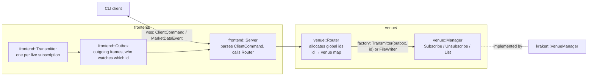

# data_feed architecture

## Data flow across threads

```mermaid
flowchart LR
    subgraph Kraken["Kraken"]
        WS[("wss://ws.kraken.com/v2<br/>book channel")]
        REST[("api.kraken.com<br/>/0/public/AssetPairs")]
    end

    subgraph Main["Main thread"]
        MAIN["main()<br/>SIGINT → stop_requested"]
        ROUTER["venue::Router<br/>global ids, id → {venue, sink}<br/>builds FileWriter / Transmitter"]
        VM["kraken::VenueManager : venue::Manager<br/>life_cycle_mutex_<br/>subscriptions_: id → {symbol, depth, sink, start, receiver}<br/>at most one per symbol"]
        PREC["kraken::FetchPairPrecision<br/>on every Subscribe"]
    end

    SUP["Supervisor thread: venue::Router<br/>every 100 ms: Connect() each unhealthy venue<br/>backoff 1 s, doubling up to 30 s"]

    subgraph Net["Network thread: net::WebsocketFeed"]
        CONN["Connection<br/>TCP → TLS SNI → WS handshake<br/>Next(): async_read, 50 ms stop poll<br/>Send(): post → outbox_ → async_write"]
        STAMP["stamp capture_time_ns<br/>UnixNanosNow()"]
    end

    RAWLOG[/"kraken_l2_messages-&lt;ns&gt;.txt<br/>raw JSON log"/]
    RFQ[["RawFrameQueue<br/>SPSC, cap 256<br/>RawFrame{json, capture_time_ns}"]]

    subgraph Parse["Parser thread: kraken::L2MessageParser"]
        DISPATCH["Dispatch()<br/>rapidjson, numbers as strings<br/>filter channel == book"]
        ROUTES{"routes_<br/>symbol → Route<br/>{PairPrecision, Receiver*, awaiting_snapshot}<br/>routes_mutex_"}
        SCALE["ScaleDecimalStringToI64<br/>ParseChecksum / ParseVenueTime"]
    end

    subgraph W1["Writer thread: BTC/USD @ 100"]
        Q1[["MessageQueue<br/>SPSC, cap 256"]]
        FW1["l2::FileWriter<br/>Serialize + flush"]
    end

        TX2["frontend::Transmitter<br/>ETH/USD @ 100"]

    BIN1[/"BTCUSD-&lt;start&gt;[-&lt;end&gt;].bin<br/>l2::FileHeader 64B + l2::Message records"/]

    STATUS(("PipelineStatus<br/>atomic failed"))

    MAIN -- "Subscribe(venue, symbol, depth, sink)" --> ROUTER
    ROUTER -- "Subscribe(id, symbol, depth, sink, factory)" --> VM
    SUP -- "Connect()" --> VM
    VM --> PREC
    PREC -- "HTTPS GET" --> REST
    VM -- "Send(subscribe / unsubscribe JSON)" --> CONN
    CONN <-- "frames" --> WS
    CONN --> STAMP
    STAMP --> RAWLOG
    STAMP -- "PushBlocking" --> RFQ
    RFQ -- "Drain" --> DISPATCH
    DISPATCH --> ROUTES
    ROUTES --> SCALE
    SCALE -- "Receive(l2::Message)" --> Q1
    SCALE -- "Receive(l2::Message)" --> TX2
    Q1 -- "Drain" --> FW1 --> BIN1

    CONN -. "Fail() on socket error" .-> STATUS
    DISPATCH -. "Fail() on exception" .-> STATUS
    STATUS -. "healthy()" .-> SUP
```



## One subscription per pair

Kraken streams a pair at one depth per connection, so a pair has at most one
subscription: sharing it would force every receiver onto one depth, and a
receiver joining mid-stream would start without a snapshot. A second
subscription to a symbol fails with `kSymbolInUse`, with one exception: a
recording of a pair already recorded at the same depth returns the existing
recording's id, since a second file would only duplicate the first. Both are
checked before and after the precision fetch. An id already in use throws
`std::logic_error`, as only a Router bug can cause it.

A subscription is identified by an id the Router hands out, unique across
venues. The manager gets the receiver from a factory the Router builds, plus
the subscription's `Sink`, which it keeps only for `List()` and for spotting
a duplicate recording.

Every subscription starts with a snapshot: the parser drops a newly attached
pair's updates until its first one, so updates still in flight from an
earlier subscription to the pair never reach the new receiver. Unsubscribing
detaches the receiver from the parser, then unsubscribes from the pair.

## Lifecycle: main → Connect → Subscribe → shutdown

```mermaid
sequenceDiagram
    autonumber
    participant M as main
    participant VM as kraken::VenueManager
    participant P as kraken::L2MessageParser
    participant F as net::WebsocketFeed
    participant K as Kraken REST/WS
    participant R as l2::FileWriter / frontend::Transmitter
    participant RT as venue::Router

    M->>VM: construct
    Note over VM: kraken::Credentials::FromEnvironment()<br/>build parser and feed sharing RawFrameQueue and PipelineStatus

    M->>RT: construct with {kKraken: VenueManager}
    Note over RT: starts the supervisor thread
    RT->>VM: Connect(), since healthy() is false
    VM->>VM: DisconnectLocked(), status_.Reset()
    VM->>P: Start() spawns parser thread
    VM->>F: Connect()
    F->>K: TCP + TLS + WS handshake
    F->>F: open raw log, spawn network thread
    VM->>F: Send(subscribe) for every subscription, none yet

    loop BTC/USD@100 kRecord, ETH/USD@100 kLive
        M->>RT: Subscribe(kKraken, symbol, 100, sink)
        RT->>VM: Subscribe(next id, symbol, 100, sink, factory)
        Note over VM: kSymbolInUse if the symbol is taken,<br/>the existing id for a duplicate recording
        VM->>K: kraken::FetchPairPrecision via AssetPairs
        K-->>VM: price_decimals, qty_decimals
        VM->>R: create (a writer opens its .bin and writes l2::FileHeader)
        VM->>P: Attach(symbol, precision, receiver)
        VM->>F: Send(subscribe)
        F->>K: async_write
    end

    loop until SIGINT; the supervisor reconnects whenever healthy() is false
        K-->>F: snapshot / update frames
        F->>P: RawFrame via RawFrameQueue
        P->>R: l2::Message via Receive(), to the pair's receiver
    end

    M->>RT: ~Router(): stop the supervisor, destroy the managers
    RT->>VM: ~VenueManager()
    VM->>F: Disconnect(): stop network thread, WS close, close raw log
    VM->>P: Stop(): drain queue, join
    Note over VM: subscriptions_ destroyed → each writer drains,<br/>closes and renames to SYMBOL-start-end.bin
```

## Frontend control API

Partly implemented: the wire protocol and the Router exist; the Server,
Outbox and Transmitter do not yet. The frontend is a CLI-like
client that talks to `data_feed` over one websocket on
`frontend::kStreamPort`, exposed publicly through a Cloudflare Tunnel.

### Commands

One venue for now, so it defaults to kraken.

| CLI | Request | Reply |
|---|---|---|
| `live start BTC/USD@100` | `Start{KRAKEN, "BTC/USD", 100, LIVE}` | `CommandResult.started_id` |
| `live ls` | `List{}`, client keeps `sink == LIVE` | `SubscriptionList` |
| `live stop 3` | `Stop{3, LIVE}` | `Ok` / `CommandError` |
| `live show 3`, Esc to leave | `Watch{3}`, then `Unwatch{}` | `StreamInfo`, then `Book`s |
| `rec start / ls / stop` | as above with `sink = RECORD` | as above |
| `play ls` | `ListRecordings{}` | recordings with ids; the client renders unix times |
| `play 7` | `Play{7}`, then `PlaybackNext{...}` | batches of `Book`s, see below |

`Stop` carries the sink the client expects, so `rec stop 3` cannot stop a
live feed by mistake (`CODE_SINK_MISMATCH`). `Book.stream_id` is the
subscription id, so `Watch{3}` yields `StreamInfo{stream_id: 3}` and
`Book{stream_id: 3}`. Live feeds, recordings and playbacks run concurrently.

### Wire protocol

`proto/market_data.proto`, compiled with `protoc` for C++ and `protoc-gen-es`
for TypeScript. On the C++ side it is the `market_data_proto` CMake target,
included as `"market_data.pb.h"` (namespace `trading::market_data::v1`). Its
headers are `SYSTEM` and its sources stay out of `PROJECT_SOURCES`, so
clang-tidy never sees them. protoc runs from a custom command rather than
`protobuf_generate`, so that the compiler's directory can be put first on
PATH: protoc needs GCC's runtime DLLs, and Git for Windows ships an
incompatible `libstdc++-6.dll`.

- Client to server: `ClientCommand{request_id, oneof command}` with `Start`,
  `Stop`, `List`, `Watch`, `Unwatch`; fields 7 to 15 reserved for playback
  (`ListRecordings`, `Play`, `PlaybackNext`, `StopPlayback`).
- Server to client: the existing `MarketDataEvent` envelope (`sequence`,
  `send_time_ns`) gains a `CommandResult{request_id, oneof result}` case:
  `started_id`, `Ok`, `SubscriptionList`, `CommandError{code, detail}`.
- `Subscription{id, venue, symbol, depth, sink, start_time_ns}` describes one
  entry of a `SubscriptionList`.
- Not `Request` / `Response` / `Error`: those would shadow JavaScript globals
  in the generated TypeScript.

Generated types stay inside `frontend/`: `frontend::Server` converts a
`ClientCommand` into plain arguments for the Router, and `l2::Message` /
subscription data into `Book` / `CommandResult`. Nothing below `frontend/`
depends on protobuf.

### Router layout



- `venue::Router` (built) allocates the id first, then builds the receiver
  factory: a `frontend::Transmitter` for `kLive` (to be bound to the Outbox
  and the id), an `l2::FileWriter` for `kRecord`. That is the only place the
  two differ. It keeps each id's venue and sink, so `Unsubscribe` can refuse
  an unknown id or the wrong sink without asking the venue.
- `venue::Manager` (built) is the interface each venue implements:
  `Connect`, `healthy`, `Subscribe`, `Unsubscribe`, `List`. It never sees
  receiver types, only the factory and the sink. Failures come back as
  `std::expected<…, venue::Error>`, whose codes mirror `CommandError::Code`
  (plus `kUnknownVenue`, which maps to `CODE_INVALID_COMMAND`). `List()`
  returns data; the CLI formats and filters it.
- The Router's supervisor thread reconnects every venue that is not
  `healthy()`, waiting `Backoff::initial` (1 s) after a failed attempt and
  doubling up to `Backoff::max` (30 s); a success resets the wait.
- The Outbox breaks the cycle between the Server (which needs the Router)
  and the Transmitters (which need to send).

### Playback flow control

The server reads a recording and sends it in batches of 10 messages as fast
as the client asks; the client, not the server, replays them at their
recorded pace (`capture_time_ns`). The client paces its requests so it never
runs dry and never holds more than it needs:

- It measures the round trip of each `PlaybackNext` to the batch it brings.
- It keeps the replay time it already holds: the recorded time between the
  message on screen and the last message buffered.
- When that held time drops below the time a request takes (about 2 × RTT,
  for headroom), it sends `PlaybackNext{playback_id, batches}`, asking for as
  many batches as it estimates it will play in that time, at least one. In a
  busy market 10 messages may cover less than one round trip, so several
  batches are in flight at once; in a quiet one a single batch lasts many.

The server never sends more than has been asked for, so a large `.bin` does
not pile up in the client's memory or on the Cloudflare connection.
